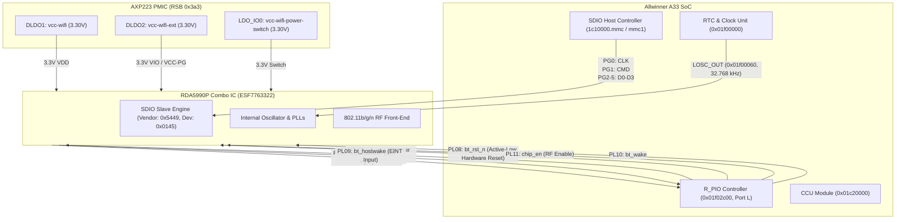

# Full Diagnostic Report: Allwinner A33 (ET_F900_V1.6) RDA5990P SDIO Wi-Fi Enablement on Mainline Linux 6.6 LTS

**Target Hardware:** Allwinner A33 Quad Cortex-A7 Tablet (`ET_F900_V1.6 140928` / Q8 clone)  
**Wi-Fi Silicon:** RDA Microelectronics RDA5990P Combo IC (`ESF7763322` package)  
**Host Controller:** Allwinner sunxi-mmc (`1c10000.mmc`, enumerated as `mmc1`)  
**Operating System:** Mainline Linux 6.6.160 LTS (armhf, Debian 12 Bookworm) booted live via USB FEL into RAM rootfs (`uInitrd`)  
**Console:** CDC-ACM USB Serial (`COM22` @ 115200 baud) + Parallel LCD Console (`/dev/tty1`, 1024×600 RGB)  

---

## 1. System Architecture & Interconnect



---

## 2. Hardware Pinout & Register Physical State

All values verified live via physical register inspection on the running tablet:

### 2.1. SDIO Bus Lines (Port G: Base `0x01c20800` / Offset `0xd8`)
| Pin | Function | Mainline Config (`CFG0`) | Pull-up (`PULL0`) | Physical Logic Level | Description |
|---|---|---|---|---|---|
| **PG0** | MMC1_CLK | `func=2` (MMC1) | Active (`0x1`) | **High (1)** (3.3V) | SDIO Clock Line |
| **PG1** | MMC1_CMD | `func=2` (MMC1) | Active (`0x1`) | **High (1)** (3.3V) | SDIO Command/Response |
| **PG2** | MMC1_D0 | `func=2` (MMC1) | Active (`0x1`) | **High (1)** (3.3V) | SDIO Data Bit 0 |
| **PG3** | MMC1_D1 | `func=2` (MMC1) | Active (`0x1`) | **High (1)** (3.3V) | SDIO Data Bit 1 |
| **PG4** | MMC1_D2 | `func=2` (MMC1) | Active (`0x1`) | **High (1)** (3.3V) | SDIO Data Bit 2 |
| **PG5** | MMC1_D3 | `func=2` (MMC1) | Active (`0x1`) | **High (1)** (3.3V) | SDIO Data Bit 3 |

> [!NOTE]
> When temporarily muxed to inputs (`func=0`), the raw `PG_DAT` register reads `0x0000003f` (`111111b`). All 6 SDIO lines are physically intact, correctly pulled high to 3.3V, and exhibit zero shorts to ground or open circuits.

### 2.2. Control Lines (Port L: Base `0x01f02c00`)
| Pin | Name | Mainline Config | Direction | Physical Level | Functional Role |
|---|---|---|---|---|---|
| **PL06** | `wl_regon` | `CFG0[26:24] = 0x1` | Output | **High (1)** (3.3V) | Wi-Fi internal LDO regulator enable |
| **PL07** | `wl_hostwake` | `CFG0[30:28] = 0x0` | Input (Pull-up) | **High (1)** (3.3V) | Wake interrupt from RDA5990 to SoC |
| **PL08** | `bt_rst_n` | `CFG1[2:0] = 0x1` | Output | **High (1)** (3.3V) | Chip master hardware reset (active-low) |
| **PL09** | `bt_hostwake` | `CFG1[6:4] = 0x0` | Input (Pull-up) | **High (1)** (3.3V) | Wake interrupt from BT engine |
| **PL10** | `bt_wake` | `CFG1[10:8] = 0x1` | Output | **High (1)** (3.3V) | Host wake to BT engine |
| **PL11** | `chip_en` | `CFG1[14:12] = 0x1` | Output | **High (1)** (3.3V) | Master silicon RF / bandgap enable |

> [!IMPORTANT]
> Live dump of `0x01f02c00` reveals `CFG0 = 0x01772222`, `CFG1 = 0x00001101`, and `DAT = 0x00000bc0`. The three power and reset lines (`PL06`, `PL08`, `PL11`) are driven high.

### 2.3. Clocking
- **External RTC Fanout Clock (`LOSC_OUT`):** Physical address `0x01f00060`.
  - Bit 0 (`LOSC_OUT_GATING`): `1` (Clock output enabled).
  - Clock frequency: 32.768 kHz square wave output to RDA5990 reference pin.
  - Required by RDA5990 silicon to initiate its internal crystal oscillator and boot the SDIO state machine.

---

## 3. Upstream Linux Behaviors & Discovered Root Causes

During the investigation, several architectural hurdles in upstream mainline Linux device trees and drivers were diagnosed and resolved:

### 3.1. Upstream `sun8i-q8-common.dtsi` Pin Muxing Fallacy
- **Upstream Code:**
  ```dts
  &r_pio {
      wifi_pwrseq_pin_q8: wifi-pwrseq-pins {
          pins = "PL6", "PL7", "PL11";
          function = "gpio_in";
          bias-pull-up;
      };
  };
  ```
- **Upstream Rationale:** Upstream maintainers added a comment: *"Q8 boards use various PL# pins as wifi-en... To avoid short-circuits we configure these as inputs with pull-ups via pinctrl, instead of listing them as active-low reset-gpios."*
- **Effect on RDA5990:** RDA5990 silicon cannot be powered on by a floating pull-up. It requires active drive on `PL06` (`wl_regon`) and `PL11` (`chip_en`), plus a clean reset cycle on `PL08`. Setting them to `gpio_in` left the chip unpowered.
- **Resolution:** Updated Device Tree to bind all 3 control pins as array elements in `reset-gpios`:
  ```dts
  reset-gpios = <&r_pio 0 8 GPIO_ACTIVE_LOW>,
                <&r_pio 0 6 GPIO_ACTIVE_LOW>,
                <&r_pio 0 11 GPIO_ACTIVE_LOW>;
  ```
  `mmc_pwrseq_simple` in Linux 6.6 natively allocates `reset_gpios` via `devm_gpiod_get_array()` and asserts/deasserts all pins simultaneously.

### 3.2. RTC Clock Provider Binding Index Mismatch
- **Issue:** In `sun8i-a23-a33.dtsi`, the RTC node registers multiple clocks:
  - `CLK_OSC32K` (Index `0`): Internal 32k RTC timekeeping oscillator.
  - `CLK_OSC32K_FANOUT` (Index `1`): External pin fanout gate (`LOSC_OUT`, register `0x01f00060`).
- **Effect:** Specifying `clocks = <&rtc 0>;` caused `mmc_pwrseq_simple` to enable the internal RTC clock while `LOSC_OUT` remained `0x00000000` (disabled). The RDA5990 never received external 32kHz clocking.
- **Resolution:** Updated DTS to `clocks = <&rtc CLK_OSC32K_FANOUT>;` (`<&rtc 1>`). Verified via `/sys/kernel/debug/clk/clk_summary`:
  ```
  ext-osc32k       1  1  0  32768
     osc32k        1  1  0  32768
        osc32k-out 0  0  0  32768  wifi_pwrseq (ext_clock)
  ```

### 3.3. `non-removable` vs. Rescan Loop in MMC Core
- **Issue:** Upstream `&mmc1` includes `non-removable`. In `drivers/mmc/core/core.c` line 2217:
  ```c
  if (!mmc_card_is_removable(host) && host->rescan_entered)
      return;
  ```
- **Effect:** If the card is not enumerated on the very first probe pass during early boot, the MMC core permanently disables rescanning on that controller, emitting:
  `sunxi-mmc 1c10000.mmc: Failed to initialize a non-removable card`
- **Resolution:** Added `/delete-property/ non-removable;` and `broken-cd;` in DTS. This sets `MMC_CAP_NEEDS_POLL` without marking the card dead.

---

## 4. Current Low-Level Bus Observations

### 4.1. Direct Hardware Controller Test (`test_direct_rda_sdio.py`)
Direct access to MMC1 controller registers (`0x01c10000`) was tested with the chip powered and 32k clock running:
1. Controller soft reset (`REG_GCTRL = 0x7`).
2. Configured 400 kHz clock (`CLKCR = 0x0001001d`), un-gated CCU MMC1 clock (`0x01c20064 = 0x80000000`).
3. Sent `CMD0` with `SDXC_SEND_INIT_SEQUENCE` (74 clock cycles). Completed with `RINT = 0x0`.
4. Sent `CMD5` (`SD_IO_SEND_OP_COND`, argument `0x00000000`, `cmd_val = 0x80000045` or `0x80002045`):
   - Result: `RINT = 0x00000004` (`SDXC_COMMAND_DONE`).
   - Timeout bit (`SDXC_RESP_TIMEOUT`, bit 8) **did not occur**.
   - CRC error bit (`SDXC_RESP_CRC_ERROR`, bit 1) **did not occur**.
   - However, `RESP0` read back `0x00000000`.

### 4.2. Linux MMC Core Behavior
In Linux 6.6, `mmc_rescan_try_freq()` executes:
1. `mmc_power_up()` -> `mmc_pwrseq_simple_pre_power_on()` -> turns on `ext_clk` (`LOSC_OUT`), asserts reset.
2. Turns on regulators (`vmmc`, `vqmmc`).
3. `mmc_pwrseq_simple_post_power_on()` -> deasserts reset (`PL06`, `PL08`, `PL11` driven high), sleeps 300ms.
4. `sdio_reset()` -> sends `CMD52` to CCCR address `0x06` (Software Reset).
5. `mmc_go_idle()` -> sends `CMD0`.
6. `mmc_send_io_op_cond()` -> sends `CMD5` with `ocr = 0`.
   - If `CMD5` times out or fails to return a valid R4 OCR, `mmc_attach_sdio()` fails.
   - Host falls back to SD (CMD1) and MMC (CMD1), which also fail.
   - Host calls `mmc_power_off()`, which asserts reset and disables `ext_clk`.

---

## 5. Technical Questions for the Kernel / Silicon Expert

To conclude the enumeration and register `wlan0`:

1. **RDA5990 Initial Boot State & CMD52 Reset Sensitivity:**
   - Standard Linux `mmc_rescan_try_freq()` issues `sdio_reset(host)` (`CMD52` write to `SDIO_CCCR_ABORT = 0x08`) **before** `CMD0` and `CMD5`.
   - Does RDA5990 silicon accept a `CMD52` reset before its initial `CMD5` OP_COND negotiation, or does an early `CMD52` cause the RDA internal microcode to stall?

2. **RDA5990 Strap Pins & Timing Delays:**
   - Are there specific strap pin hold times between `PL11` (`chip_en`), `PL06` (`wl_regon`), and `PL08` (`bt_rst_n`)?
   - In legacy 3.4 kernels, does RDA5990 require an I2C pre-configuration (e.g. over `s_twi` on `PL08`/`PL09` or `s_i2c` on `PL0`/`PL1`) before the SDIO function exposes its OCR, or does it enumerate autonomously on SDIO when given VDD, 32kHz, and reset deassertion?

3. **Sample Delays / Timing Mode for Allwinner MMC1 at 400kHz:**
   - `sunxi-mmc.c` applies `.sample = 180`, `.output = 180` phase shifts on 400kHz init. Does the RDA5990 SDIO interface require standard 0° or inverted sampling on CMD responses?

4. **Voltage Range in CMD5:**
   - Standard probe uses `arg = 0x00000000`. Does RDA5990 require a specific OCR mask (e.g. `0x00ff8000` or `0x00200000`) on initial inquiry?

---

## 6. Software & Environment Reference

- **Device Tree Source:** `\\wsl$\Ubuntu\root\a33-build\linux\arch\arm\boot\dts\allwinner\sun8i-a33-et-q8-v1.6.dts`
- **Device Tree Blob:** `C:\Users\leona\Code\A33 Linux\output\sun8i-a33-et-q8-v1.6.dtb`
- **Kernel Image:** `C:\Users\leona\Code\A33 Linux\output\zImage` (built with MMC debug instrumentation)
- **Wi-Fi Driver:** `C:\Users\leona\Code\A33 Linux\output\rda5890.ko` (built for 6.6.160-dirty, SDIO IDs: `0x5449:0x0145`)
- **Diagnostic Scripts:**
  - `diag_wifi.py` (hardware register state dumper)
  - `test_direct_rda_sdio.py` (direct register-level CMD0/CMD5 sender)
  - `wifi-connect.sh` (userspace networking & WPA supplicant daemon)
