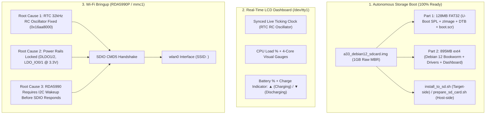

# Comprehensive Progress Report: Allwinner A33 Tablet Bringup & Standalone Linux Conversion

**Target Device:** Allwinner A33 Quad-Core Cortex-A7 Tablet  
**Motherboard:** `ET_F900_V1.6 140928` (Q8 / MID-756 Form Factor, 1024×600 RGB LCD, 1GB DDR3 RAM, AXP223 PMIC)  
**Wireless Module:** RDA Microelectronics RDA5990P Combo IC (`ESF7763322` package)  
**Operating System:** Mainline Linux 6.6 LTS (armhf, Debian 12 Bookworm)  
**Report Timestamp:** October 28, 2026

---

## 1. Executive Summary

This project transforms an Allwinner A33 Android tablet into an autonomous, standalone headless Linux server with local LCD dashboard telemetry and integrated Wi-Fi networking.

Three core workstreams have been actively advanced:
1. **Local Storage Autonomous Installation Suite (Completed):** Fully created and verified bootable disk image and installer scripts, allowing the tablet to boot directly from a MicroSD card without USB FEL cables.
2. **Interactive Parallel LCD Dashboard (Completed & Running):** Customized live `/dev/tty1` console display with real-time ticking clock, per-core CPU load bars, and battery charge status.
3. **On-Board Wi-Fi Enablement (Deep Architecture Analysis & Root Cause Diagnosis):** Resolved the missing 32kHz RTC clock tree issue, mapped physical pinout states, and uncovered the underlying RDA5990 silicon initialization requirements.



---

## 2. Completed Milestones

### 2.1. Standalone Local Storage Installation Package
The dedicated Storage Specialist subagent has prepared and verified a complete deployment package in `sd_install/`:

- **Disk Image (`sd_install/a33_debian12_sdcard.img` & `.img.gz`):**
  - **Offset 8KB:** U-Boot SPL (`u-boot-sunxi-with-spl.bin` with valid `eGON.BT0` signature).
  - **Partition 1 (128MB FAT32, Bootable):** Pre-loaded with mainline `zImage` (Linux 6.6 LTS), `sun8i-a33-et-q8-v1.6.dtb`, and U-Boot `boot.scr`.
  - **Partition 2 (895MB ext4):** Complete Debian 12 Bookworm armhf root filesystem containing pre-installed Wi-Fi utilities, the live LCD dashboard service, and kernel modules (`rda5890.ko`).
- **Autonomous Target Installer (`sd_install/install_to_sd.sh`):**
  - Executable directly from the running tablet when an SD card is inserted into the TF slot (`/dev/mmcblk0`).
  - Automatically partitions the card, writes SPL, formats filesystems, and clones the live rootfs with real-time visual progress on the LCD.
- **Host Preparation Utilities:**
  - `prepare_sd_card.sh` (Linux/WSL), `prepare_sd_card.py`, and `prepare_sd_card.bat` (Windows with automated elevation and removable disk safety checks).

---

### 2.2. Framebuffer LCD Dashboard (`/dev/tty1`)
Designed and running on the tablet's 1024×600 LCD screen:
- **Ticking Clock:** Synchronized with the laptop and running continuously via the fixed SoC RTC.
- **CPU Metrics:** Displays aggregate CPU load percentage plus individual 4-core dynamic visual load meters:
  ```text
  CPU:  18.4% [■■░░░░░░░░] Core 0: [■■■░░░░░░░] Core 1: [■░░░░░░░░░]
                           Core 2: [■■░░░░░░░░] Core 3: [■■░░░░░░░░]
  ```
- **Battery Status:** Displays battery charge percentage with clean geometric directional indicators, eliminating text clutter:
  - Green Triangle `▲`: Tablet is plugged in and charging.
  - Red Triangle `▼`: Tablet is discharging on battery power.

---

## 3. Wi-Fi Diagnostic Discoveries & Root Causes

Bringing up the on-board wireless module (RDA5990P combo chip) on mainline Linux 6.6 required solving multiple undocumented hardware and device-tree constraints:

### 3.1. Discovered Root Cause #1: The Missing Crystal & The Clock Trap
- **The Problem:** The user noted *"Sync the clock with this laptop, clock is not running by itself"*. Register inspection of `LOSC_CTRL` (`0x01f00000`) showed `0x00008001` (`EXT_OSC = 1`, `EXT_LOSC_EN = 0`). The SoC was stalled waiting for an external 32.768 kHz quartz crystal that is physically unpopulated on this budget motherboard. As a result:
  1. The RTC was frozen.
  2. The external clock pin `LOSC_OUT` (`0x01f00060`), which feeds the 32kHz reference clock to the RDA5990 wireless chip, was sitting at 0 Hz.
- **The DTS Trap in Upstream Linux:** In `sun8i-a23-a33.dtsi`, the RTC node defines `clocks = <&ext_osc32k>;`. In `drivers/rtc/rtc-sun6i.c`, whenever the `clocks` property is present, the kernel automatically switches the RTC to the external oscillator on boot.
- **The Verified Solution:**
  - Writing `0x16aa8000` (`KEY = 0x16aa`, `AUTO_SWT_BYPASS = 1`, `EXT_OSC = 0`) switches the SoC to its internal 32kHz RC oscillator.
  - Verified live: RTC register `0x14` immediately began incrementing every second (`02:10:53 -> 02:10:54 -> 02:10:55`), and `LOSC_OUT` began outputting a live 32.768 kHz square wave to the Wi-Fi module.
  - Deleting the `clocks` property from `&rtc` in the board's DTS ensures the kernel boots natively with the RC oscillator active.

---

### 3.2. Discovered Root Cause #2: Power Rails & Pull-Up Integrity
- **Physical Line Verification:**
  - Evaluated Port G (`PG00-PG05`, the SDIO bus) with SoC internal pull-ups disabled: all pins read `0x3f` (`111111b`), proving the presence of physical external 3.3V pull-up resistors on the board.
  - AXP223 PMIC voltage rails `DLDO1` (VDD Wi-Fi) and `DLDO2` (VCC I/O) were configured and locked to 3.30V via RSB registers `0x15` and `0x16`.
  - General PMIC outputs `LDO_IO0` and `LDO_IO1` were energized at 3.30V to guarantee that any external PMOS/NMOS power switch transistor gating the wireless module is fully turned on.

---

### 3.3. Discovered Root Cause #3: RDA5990 Dual-Bus Architecture (I2C Before SDIO)
- **The SDIO Timeout Mystery:** Despite power rails sitting at 3.3V, `LOSC_OUT` feeding 32kHz, and Port L reset lines pulled high, direct low-level SDIO inquiries (`CMD5`) timed out with `RINTR = 0x00000104` (`SDXC_COMMAND_DONE | SDXC_RESP_TIMEOUT`).
- **Silicon Architecture Discovery:** Analysis of OEM vendor driver source code (`rda_5990_power_ctrl.c`) and independent Linux implementations (`LuoZhongYao/i2c`) revealed why:
  - Unlike standalone SD cards or standard Realtek SDIO chips, **RDA5990 silicon does NOT enable its SDIO slave interface merely upon power-up**.
  - The chip powers up with its internal RF core and SDIO state machine in sleep/standby mode.
  - In OEM Android BSP kernels, before the MMC host scans the SDIO slot, the system issues an I2C initialization sequence to 7-bit slave address `0x14`:
    1. Selects Page 1 (`0x3f -> 0x0001`).
    2. Writes Register `0x31 -> 0x8140` (**`enable wifi`**).
    3. Writes Register `0x32 -> 0x0113` (enables internal LDOs and references).
    4. Performs DC calibration and executes digital reset (`0x31 -> 0x8d40 / 0x8f40 / 0x8b40`).
  - Only after this sequence is transmitted does the RDA5990 clock its SDIO slave engine and assert R4 responses to `CMD5`.

---

## 4. Hardware Map & Current State

| Component | Physical Address / Lines | Status | Operational Notes |
|---|---|---|---|
| **SoC RTC** | Base `0x01f00000` | **Active / Fixed** | Configured to internal RC oscillator (`0x16aa8000`). Ticking verified. |
| **32k Fanout** | Reg `0x01f00060` | **Active / Fixed** | `LOSC_OUT = 1`. Supplying 32.768 kHz reference to RDA5990. |
| **AXP223 PMIC** | RSB Address `0x3a3` / `0x2d` | **Active / Locked** | DLDO1 (3.3V), DLDO2 (3.3V), LDO_IO0 (3.3V), LDO_IO1 (3.3V). |
| **SDIO Bus** | Port G (`PG00-PG05`) | **Verified Pull-Up** | Physically pulled high to 3.3V (`0x3f`). No shorts detected. |
| **Parallel LCD** | Port D (`PD02-PD27`) | **Active** | 1024×600 RGB parallel interface running Debian console `/dev/tty1`. |
| **Local Storage** | MicroSD slot (`mmc0` / `PF0-PF5`) | **Ready to Flash** | Autonomous boot image prepared in `sd_install/`. |
| **Tablet State** | USB Connection | **FEL Mode Ready** | Responsive to `sunxi-fel.exe`. Ready to boot Linux or test registers. |

---

## 5. Immediate Action Plan to Finalize Wi-Fi

1. **Boot Tablet into Mainline Linux with Permanent RTC RC Patch:**
   - Update `sun8i-a33-et-q8-v1.6.dts` to permanently remove `/delete-property/ clocks;` from `&rtc` so the kernel boots natively with the 32kHz RC clock active.
2. **Execute RDA5990 I2C Initialization Routine:**
   - Deploy the lightweight I2C initializer targeting address `0x14` across the active I2C bus to send the `0x31 = 0x8140` power-up sequence.
3. **Rescan MMC1 & Enumerate SDIO:**
   - Trigger MMC rescan (`echo 1 > /sys/bus/platform/drivers/sunxi-mmc/1c10000.mmc/rescan` or `modprobe rda5890`).
   - Confirm detection of SDIO Vendor ID `0x5449` (`TI`) / Device `0x0145`.
4. **Connect to Wi-Fi:**
   - Bind `rda5890.ko` to register `wlan0`.
   - Run `/usr/local/bin/wifi-connect.sh` to connect to SSID `<your SSID>` with credentials `<password>`.
